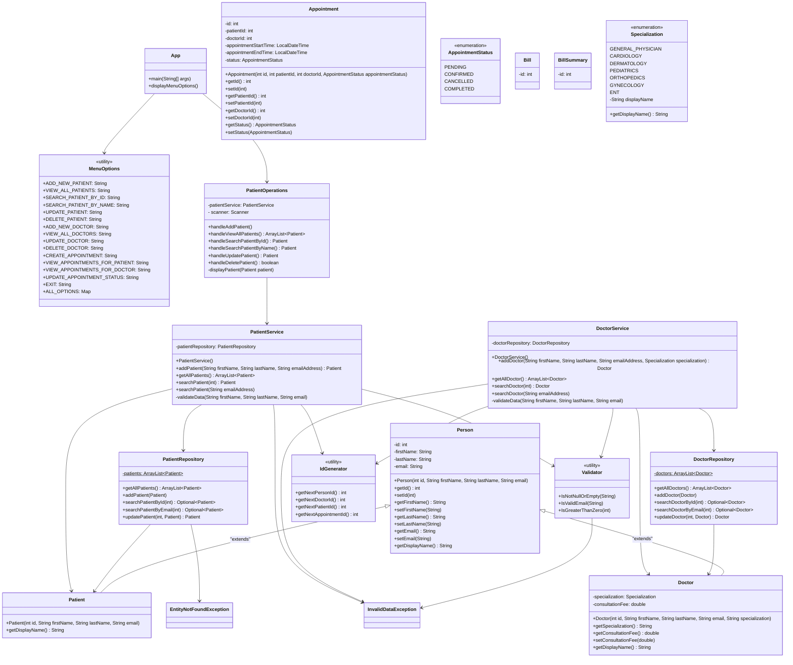

# MediTrack — Clinic & Appointment Management System

MediTrack is a console-based Clinic & Appointment Management System built using Core Java.
It will allow admins to manage:

- Patients
- Doctors
- Appointments

MediTrack is a Java console application built with [Apache Maven](https://maven.apache.org/).

## Prerequisites

Before you begin, ensure you have the following installed on your system:

- **Java Development Kit (JDK)**: Version 17 or higher
- **Apache Maven**: Version 3.9.0 or higher [Setup Guide](https://maven.apache.org/install.html) OR `choco install maven`

## Steps to run the app:

Clone the app locally and run following commands in the terminal,

```bash
mvn clean package -DskipTests

java -cp target/meditrack-1.0-SNAPSHOT.jar com.airtribe.meditrack.App
```

Class Diagram:


